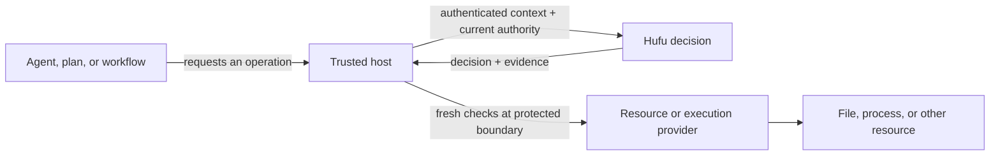

# Penghou.Hufu

**Hufu is a reusable authority boundary for software that performs work on someone's behalf.** It helps a host answer a specific question before a protected operation: *may this authenticated subject perform this action on this resource, right now?* It also records the evidence for the decision so a host can explain and recover it later.

An agent, plan, or workflow can request work; its request does not grant permission. The host supplies trusted identity, policy, current authority, approvals, and resource bindings. Hufu evaluates those inputs. The host and its resource or execution providers enforce the result at the point of use.



The [authority and delegation model](docs/authority-delegation-enforcement.md)
explains how live authority, child grants, broker checks and execution policies
fit together. One activity can use zero or many executions. Biscuit is an optional
future carrier across those boundaries; the first selected proof is a worker
calling a host broker. Published Gagamba providers currently supply process
lifecycle guarantees; restricted execution remains separately gated.

## What this repository provides

- **Core authority contracts:** bounded requests, grants, current snapshots, decisions, revocation, authenticated issuance, derived-grant lineage, and required decision evidence.
- **Optional adapters:** Cedar policy evaluation; SQLite current-authority and evidence storage; neutral workflow authorization; resource checks through Penghou.IO; and a governed single-file patch host built with Luban's conditional writer.
- **Examples and experiments:** a local Windows operator host for one exact file, plus separate plan and native-execution compositions. These show specific integration profiles, not a general-purpose production host.

Hufu does not authenticate a user by itself, schedule workflows, own resource providers, or isolate arbitrary code. Each integrating host must supply and qualify those boundaries. The [overview](docs/overview.md) explains how the parts fit together and where checks must occur.

## Current status

Nine Hufu packages are published at **`0.1.0-preview.8`** for .NET 8 and .NET 10: `Penghou.Hufu`, `Penghou.Hufu.Cedar`, `Penghou.Hufu.Sqlite`, `Penghou.Hufu.Workflow`, `Penghou.Hufu.IO`, `Penghou.Hufu.Luban`, `Penghou.Hufu.Luban.Sqlite`, `Penghou.Hufu.Biscuit`, and `Penghou.Hufu.Biscuit.Sqlite`. They are pre-release components with explicit host obligations. The [release profile](docs/package-release-profile.md) is the source for package contents, compatibility, and publication evidence. Avoid `0.1.0-preview.4`, which was an incomplete release.

The [single-patch host](docs/single-patch-host.md) and [local Windows host example](samples/Hufu.LocalHost/README.md) demonstrate one governed mutation path. The neutral [workflow adapter](docs/workflow-authorizer.md) performs authorization before protected activity code; it does not by itself coordinate a filesystem mutation with revocation. The published Biscuit packages carry an experimental credential adapter whose behavior remains gated by current Hufu authority; the Fuwen/Zhinu/Gagamba execution compositions remain separate experimental, unpublished work. [Luban integration](docs/luban-integration.md) remains available for existing consumers, while new Hufu work is [language-neutral](docs/roadmap.md).

## Start here

| If you want to… | Read |
| --- | --- |
| Understand the goal and trust boundaries | [Overview](docs/overview.md) |
| Choose an integration point | [Architecture](docs/architecture.md) and [documentation guide](docs/README.md) |
| Integrate a workflow engine | [Workflow authorizer](docs/workflow-authorizer.md) |
| Govern concrete resource access | [Resource adapter](docs/resource-package-adoption.md) and [single-patch host](docs/single-patch-host.md) |
| Run the bounded operator example | [Local host README](samples/Hufu.LocalHost/README.md) |
| Check published versions and evidence | [Package release profile](docs/package-release-profile.md) |
| See planned and unfinished work | [Roadmap](docs/roadmap.md) and [authority/enforcement implementation plan](docs/authority-enforcement-implementation-plan.md) |

To explore the source, install the .NET 10 SDK and the .NET 8 runtime (for the .NET 8 test targets) and run from the repository root:

```powershell
dotnet build Penghou.Hufu.Core.slnx -c Release
dotnet test Penghou.Hufu.Core.slnx -c Release
```

`Penghou.Hufu.Core.slnx` contains the core and newer experimental compositions. `Penghou.Hufu.slnx` includes the published adapters, the local Windows host, and legacy/optional integration tests; see the [release profile](docs/package-release-profile.md) for their different restore and platform requirements. The [local host guide](samples/Hufu.LocalHost/README.md) gives a concrete Windows run path.

Licensed under the [Apache License 2.0](LICENSE).
