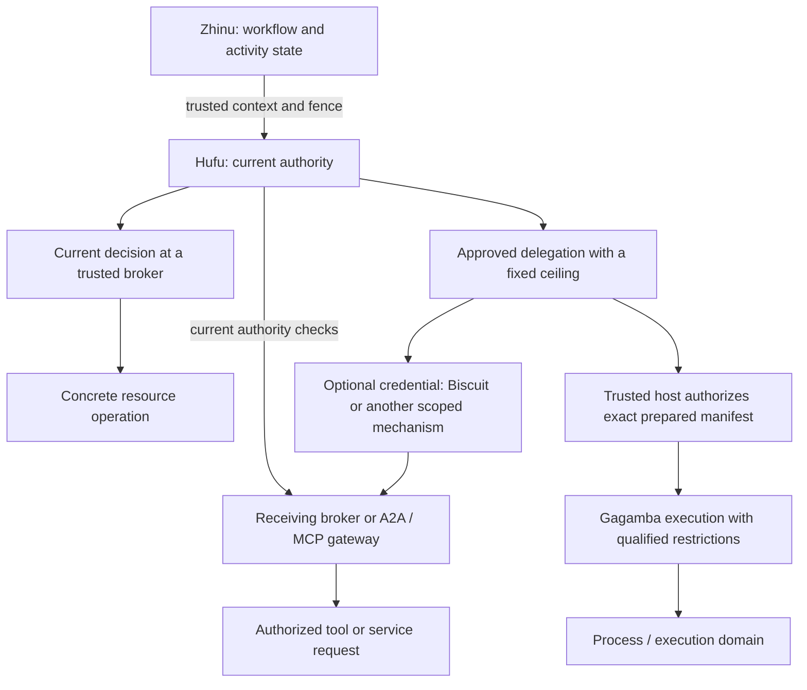

# Authority, delegation and enforcement

Status: design clarification, 2026-10-11. [ADR 0014](decisions/0014-authority-delegation-enforcement.md)
records the decision. This is the canonical explanation of the boundaries;
the [reconciliation review](authority-model-review.md) distinguishes existing
implementation from the [remaining delivery gates](roadmap.md). The original
[user proposal](archive/authority-delegation-enforcement-proposal-2026-10-11.md)
is preserved as input, with the clarifications below.

## Ownership

**Hufu decides authority. A trusted broker enforces it per operation. An execution
provider enforces the restrictions it has actually qualified. Biscuit can carry
a constrained delegation between trusted enforcement points.**

| Owner | Owns | Does not establish by itself |
| --- | --- | --- |
| Hufu and its authenticated host services | Grants, derivation, authority decisions, approvals, revocation and authority evidence | OS isolation, workflow state or the identity of a caller merely presenting an ID |
| Zhinu or another runtime | Workflow state, attempts, leases/fences, suspension and recovery | Permission to perform effects |
| Trusted broker / gateway | Authentication at its boundary, exact request mapping, current checks, provider dispatch and result release | Restrictions on unrelated direct calls or downstream internal behavior |
| Gagamba | Execution preparation, negotiated provider guarantees, lifecycle and execution evidence; restricted execution where qualified | The decision that a principal deserves authority |
| Biscuit adapter | A versioned credential representation, verification and attenuation consistent with Hufu | Current permission, actor authentication or process confinement from token possession alone |
| Qingniao / host integration | Delegated-work lifecycle, selected provider and correlation | New grants inferred from delegation labels or provider capabilities |

Hufu's authority state and Zhinu's workflow state are separate sources of truth.
Workflow facts are authenticated, versioned inputs to authority decisions. Starting,
suspending, resuming, retrying or compensating may require re-evaluation and host
policy transitions; none of those events automatically grants or revokes rights.
Hufu also supports standalone subjects without a workflow.

## One activity can use several enforcement paths

An activity has **zero to many executions**, each with its own operation identity,
authority binding and supported enforcement profile. It may use only brokers,
only a restricted execution, or a composition of both. Biscuit is optional on
either path; Gagamba need not parse a token itself.

Multiple activities inside one trusted .NET process share its ambient OS powers.
An activity that can bypass a broker with `File.Open`, `HttpClient` or
`Process.Start` is not confined by Hufu's logical activity boundary. A mediated
profile must state whether it trusts callers to use the broker or has independently
qualified a mechanism that prevents bypass.

The published Gagamba native providers currently supply **process lifecycle**
guarantees. They do not implement Hufu filesystem grants, denied network or
credential isolation. Gagamba's separate [restricted-execution decision](../../Gagamba/docs/adr/0003-ar7-linux-first-restricted-execution.md)
selects a Linux implementation direction whose production qualification remains
pending. A profile requiring isolation must refuse an ordinary lifecycle provider.

## Three different operations

1. **Derive a grant.** An authenticated actor requests authority for a child.
   Hufu proves typed containment and checks the actor's permission to derive.
   Having permission to read does not imply permission to grant someone else read
   access. See [lineage](decisions/0012-derived-authority-lineage.md) and
   [delegability](decisions/0013-delegability-of-derived-authority.md).
2. **Represent or narrow that authority.** A credential may represent the approved
   child grant and impose further restrictions. Narrowing a Biscuit does not
   independently create a Hufu grant, change its subject or enlarge its audience.
3. **Prepare an enforcement instance.** The host maps the authorized intent to a
   concrete provider profile. Preparation binds actual objects, runtime inputs,
   environment, channels and limits. The host must authorize that exact effective
   manifest before release; provider discovery cannot silently add authority.

A derived grant is bounded by its parent at issuance. At use time, permission
must also satisfy the delegation's fixed ceiling, current child/ancestor validity,
applicable current policy, exact resource and audience bindings, and any required
workflow fence or effect approval. A later parent expansion never enlarges an
existing child. A parent restriction or revocation must not be bypassed through a
stale child. The qualified use-time rule is frozen in the
[ADR 0014 amendment](decisions/0014-authority-delegation-enforcement.md#amendment-2026-10-12-ae-10-current-derived-authority-use-time-rule):
the exact operation needs both the child's own Permit and a Permit under every
applicable current parent restriction. "Applicable current parent restriction"
means the current restrictions from the authority lineage and profile that
contributed to the child's authority and that govern the requested operation,
not every arbitrary policy associated with the parent subject. Full current
parent-policy composition is qualified only for the first root-then-direct-child
profile; the ancestor-liveness helper alone does not implement it, and
unsupported lineage shapes fail closed rather than joining the qualified
contract; see the [source review](authority-model-review.md).

## Authority changes and execution lifetime

| Change | Required treatment |
| --- | --- |
| Retry within the same delegation and generation | Reauthorize the operation. An idempotently issued child grant may be reused if still valid; an execution retry uses a fresh preparation and execution. |
| New generation, audience, subject, resource binding or wider requested authority | Resolve and approve a new delegation/binding. An old token or decision cannot expand itself. |
| Revocation or a new denial | Reject later uses according to the receiving boundary's ordering contract. No replacement token is needed to make an old delegation unusable. |
| New OS restrictions or permissions for a running execution | Stop/reconcile as required, then prepare and authorize a new execution. Do not mutate the old policy implicitly. |
| Ordinary resume without changed authority meaning | Validate the current workflow fence and authority again. Resume alone neither forces a new grant nor revives an invalidated one. |
| Delegability approval withdrawn | Block new derivations according to the issuance gate. Already issued children remain subject to their own validity and ancestor liveness. |

Generic execution-lifecycle authority (Active/Suspended/Terminal) is separate
Hufu authority state, distinct from terminal grant revocation. Authenticated
workflow events are translated into neutral lifecycle transitions and can
quiesce or close a binding without creating new rights; see the
[execution-lifecycle authority profile](execution-lifecycle-authority.md).

For the first restricted-execution profile, the execution policy is immutable.
This means a fixed authorized ceiling, not a promise that access must remain
available: broker decisions can deny more, leases can expire, and the host can
terminate an execution. Files or remote services can also change independently.
To widen broker authority for an already running worker, require an explicitly
reviewed new binding; the initial profile uses a fresh execution instead.

Do not describe online revocation as instantaneous global cancellation. Distinguish:

- **New-operation admission:** what freshness and start ordering the broker proves.
- **Existing operations:** whether a read, stream, open handle or remote task may
  finish, is cancelled, or must be drained before acknowledgement.
- **Execution termination:** a host requests stop and records the provider's actual
  completion or failure. Revoking a database record does not kill a process.

A final lookup followed by launch is not an atomic revocation/start protocol.
The existing [single-patch profile](single-patch-host.md) supplies a specific
shared-database ordering guarantee. The experimental native launch path does not
inherit it. Stop cannot undo data already disclosed or effects already committed.

## Biscuit's useful role, later

Biscuit is a candidate for portable, attenuable credentials. Its distinct value
is that a holder can append restrictions verifiable with the issuer's public key;
that can help when a worker, broker and further service need independently
verifiable limits. This does not require Hufu core or third-party tools to depend
on Biscuit. [Biscuit's specification](https://doc.biscuitsec.org/reference/specifications)
describes the format and its offline attenuation capability.

| Situation | Initial choice |
| --- | --- |
| Trusted in-process call | Authenticated host-bound context; no token required. |
| One online worker calling one broker | A scoped opaque reference may suffice; compare it with Biscuit using the same authority tests. |
| Several trusted receiving services or constrained onward delegation | Biscuit becomes useful if portable verification/attenuation removes a concrete integration obstacle. |
| Work must continue disconnected from authority services | Separate future profile with explicitly accepted revocation staleness; excluded from the first proof. |
| Arbitrary code can directly access a file/socket | Require an appropriate enforcement boundary; a credential cannot remove ambient access. |

**The selected first later proof is worker → host broker**, using one bounded read
profile and online current-authority checks. First prove the broker using existing
Hufu contracts, then compare an optional Biscuit carrier. A trusted/cooperative
worker can prove the protocol; hostile-worker containment is a separate gate.
There is no requirement to launch a sandbox merely to test credential transport.

The existing [registered Biscuit prototype](biscuit-integration-profile.md) is
narrower than Biscuit's general capabilities: every accepted token fingerprint
and descendant is registered; attenuation preserves the subject and execution
bindings; current Hufu/Cedar and both evidence stores are required. It rejects
unregistered offline descendants. Changing recipient or audience needs an approved
issuance/exchange profile, not a relabeled existing token. Core grant lineage and
the older Biscuit registration chain must be reconciled before using this prototype
as a general delegation carrier.

The receiving broker must validate trusted issuer/key selection, token integrity,
registered lineage, exact audience and authenticated workload binding, expiry,
current Hufu authority and policy, concrete resources, required evidence, and the
operation's replay/start rules. Token facts do not authenticate the presenting
process. Treat the credential as bearer material unless a separately qualified
channel or proof-of-possession binding prevents reuse by another holder. Keep it
out of prompts, tool arguments, workflow payloads and ordinary logs.

Online checks fail closed when current state is unavailable in this initial
profile. Expiry only bounds lifetime; it does not supply immediate revocation.
Biscuit revocation itself requires external state, as explained in the
[upstream revocation guide](https://www.biscuitsec.org/docs/guides/revocation/).
Registration/online checks intentionally give up disconnected use in exchange
for the selected Hufu semantics. Do not describe offline attenuation as permission
to bypass Hufu's derivation approval.

## A2A, MCP and downstream agents

These are future adapter profiles, not new permissions already present in the
core enum. Hufu currently has bounded file/resource actions and `ExecuteProcess`;
`agent:codex`, `web-search`, arbitrary HTTP and `CanInvokeTool` in examples are
design vocabulary until their mappings and effects are qualified.

An Hufu-aware gateway authenticates the caller, verifies the delegation, maps an
exact semantic operation, checks current authority, and authorizes disclosure to
the named destination. A controlled MCP server can do this in an adapter around
handlers. A third-party server receives its own scoped downstream credential or
an ordinary authorized request, not a forwarded internal Hufu credential.

Qingniao's [protocol boundaries](../../Penghou.Qingniao/docs/protocol-boundaries.md)
place northbound MCP in Marang and A2A among optional southbound providers. Keep
those transports outside Hufu core and preserve each component's ownership.

Filtering an advertised tool list is insufficient. The gateway can enforce only
operations it controls. A remote agent with its own shell or network access may
still exercise those powers internally. A "shell denied" profile needs verified
provider restrictions and bypass closure, or must refuse that provider. A scoped
input snapshot plus candidate output can be a separate, explicitly approved
profile with its own data-release and local-apply checks.

A worker-to-broker channel also needs an actual supported transport. Gagamba's
first restricted offline profile denies ambient host-service access and permits
only prepared data channels. Do not silently add a socket or arbitrary stdio RPC
bridge to make the diagram work; review the required channel and its effects in
a separate broker-enabled profile.

## Example: one activity, two generations

This is illustrative policy, not executable syntax. Activity A has a current
read ceiling for workspace `repo`, write rights for `output`, and a separately
approved search capability. It delegates only `repo` reads to worker W1, with
audience `repo-broker`, a fixed expiry and a bound delegation generation.

W1 asks the broker to read `src/a.cs`. The broker authenticates W1, checks the
delegation and current parent/child authority, resolves the actual target, and
authorizes content release. A request to write `output` is denied even though
the activity's own grant permits it. If an optional Biscuit is used, it carries
the same restricted binding and does not change the result.

Later the activity gains another resource. W1 gains nothing. If the host needs
a worker with the additional rights, it approves a new delegation generation
and, for the initial execution profile, starts W2 under a newly prepared policy.
If A instead loses `repo` read authority, W1's next read is denied online without
minting another token. Suspension triggers whatever invalidation/stop policy the
host has explicitly configured; it is not itself a universal revocation command.

## Terms

| Term | Meaning |
| --- | --- |
| Activity authority | Effective logical authority bound by the host to a particular activity/context; not a second OS identity. |
| Delegated authority | An approved ceiling for a child subject or delegation, with explicit lineage and validity. |
| Execution authority | The delegated ceiling and exact binding selected for one concrete execution. |
| Sandbox / enforcement policy | The immutable concrete restriction profile that an execution provider can actually enforce. |
| Current authority | Hufu's present usable authority under authenticated host inputs and applicable policy; workflow state remains runtime-owned. |
| Credential attenuation | Additional restrictions on a credential; does not automatically create another Hufu child grant. |
| Execution domain | A provider-owned lifecycle unit; the term alone makes no confinement claim. |

See the [roadmap](roadmap.md) for staged acceptance criteria and the
[review](authority-model-review.md) for implementation gaps and decisions still
required before broader enforcement claims.
