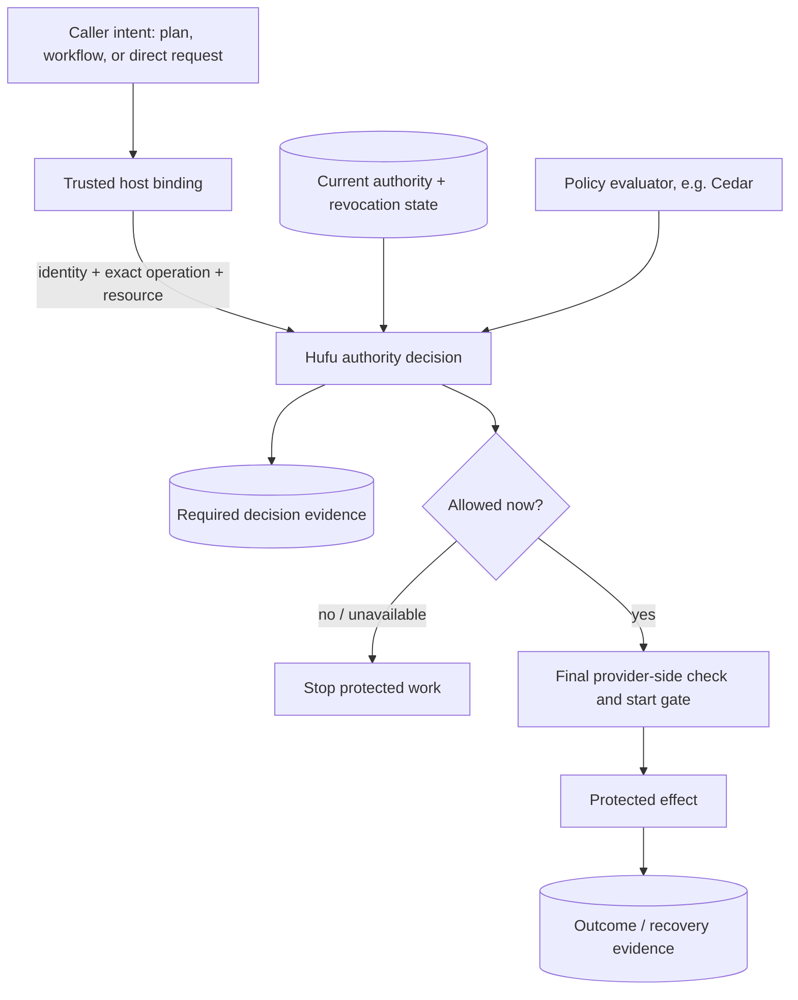

# How Hufu fits into an execution host

Hufu is the authority layer in a larger system. It decides whether a specific operation is covered by current, authenticated authority and records the decision. A caller's intent, a plan's structure, or an old approval is never sufficient on its own.

For changing authority, child grants and execution lifetimes, read the
[authority and delegation model](authority-delegation-enforcement.md). Hufu owns
authority state; a workflow runtime owns workflow state. A trusted host binds
the two. Each activity can use 0..N executions or only mediated operations.
The first execution policy is immutable; a broader grant never silently widens
an existing execution. Biscuit is an optional credential carrier, with a later
worker-to-broker proof in the [roadmap](roadmap.md).

## The problem

A workflow can restart, an agent can propose new actions, and permissions can change while work is in progress. A one-time "allow" at plan submission cannot safely stand in for a check at the moment a file is opened or a process starts. The system also needs durable evidence of *which* subject, operation, resource, policy result, and authority version justified an action.

Hufu provides contracts and adapters for these decisions. The host still owns authentication, policy choice, approval custody, provider composition, and protection of its storage and resource namespace.

## The boundaries

1. **Bind the request.** The host authenticates the actor and resolves the exact operation, resource, and execution context. Caller-supplied IDs are correlation data, not credentials.
2. **Evaluate current authority.** Hufu checks the current snapshot, relevant restrictions and policy result, and records required decision evidence. Missing or inconsistent evidence blocks permission.
3. **Enforce at the effect boundary.** A trusted provider checks the concrete resource and current permission when access actually begins. A workflow preflight can stop unwanted work early, but cannot replace this check.
4. **Record the outcome.** Mutations need an operation-specific start/outcome protocol so recovery does not silently repeat an uncertain effect. The published single-patch adapter implements this for one narrow file profile.

Revocation and start need a defined order. In the single-patch profile, the start gate and revocation share one SQLite writer order: a revocation that commits first blocks the start; a start that commits first may finish. This is a **block-new-starts** guarantee, not termination of already started work.

## Who owns what?

| Component | Responsibility |
| --- | --- |
| **Hufu core** | Authority contracts, bounded evaluation, grant/lineage rules, decisions and evidence contracts. |
| **Hufu.Cedar / Hufu.Sqlite** | Optional policy evaluation and durable current-authority/evidence adapters. |
| **Hufu.Workflow** | Authorization through the product-neutral `Penghou.Workflow.Abstractions` contract. It has no workflow-engine dependency. |
| **Hufu.IO / Hufu.Luban.Sqlite** | Optional resource mediation and the narrow governed single-patch start/outcome path. |
| **Host** | Real authentication, issuer and approver authority, policy, resource binding, protected storage, trusted provider wiring and operator interface. |
| **Workflow runtime (for example, Zhinu)** | Scheduling, attempts, leases, durable workflow state and recovery. |
| **Resource or execution provider** | Final concrete access checks and the actual effect; external isolation only where a qualified provider supplies it. |

The dependency direction is deliberate: Hufu core does not depend on a workflow engine, a command language, or a specific resource provider. Optional adapters join it to those systems. [ADR 0011](decisions/0011-neutral-zhinu-authority-extension.md) explains the neutral workflow seam; the [architecture](architecture.md) has the detailed ownership model.

## What can I use now?

- The seven published `0.1.0-preview.5` packages cover the core, Cedar/SQLite, workflow and resource adapters, and the governed single-patch adapter. See the [release profile](package-release-profile.md) for exact evidence and version cautions.
- The [local Windows host](../samples/Hufu.LocalHost/README.md) demonstrates real operator identity, exact approval, protected state and one exact UTF-8 file on controlled NTFS. Its scope and open product-host work are in the [host profile](local-host-services.md).
- The [plan host](../samples/Hufu.PlanHost/README.md) and [sandbox runner](../samples/Hufu.SandboxRunner/README.md) demonstrate separate experimental compositions. Their docs state which guarantees have and have not been qualified.

The broader [authority specification](workflow-authority-spec.md) and [roadmap](roadmap.md) describe goals beyond these delivered profiles. Treat each profile's own documentation and qualification record as the source for its actual guarantees.
